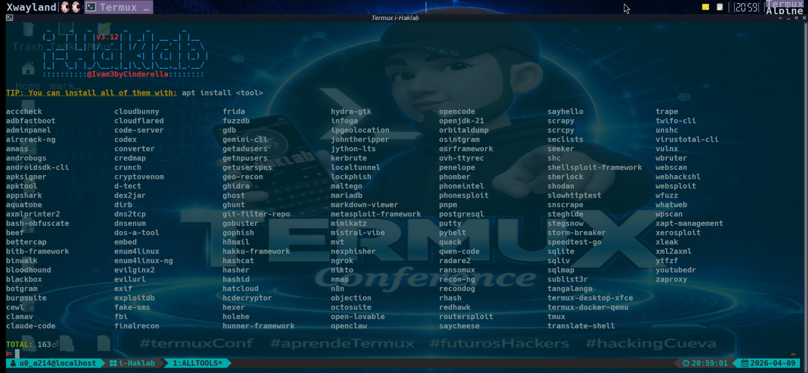
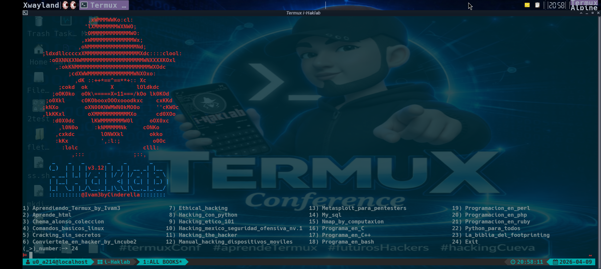
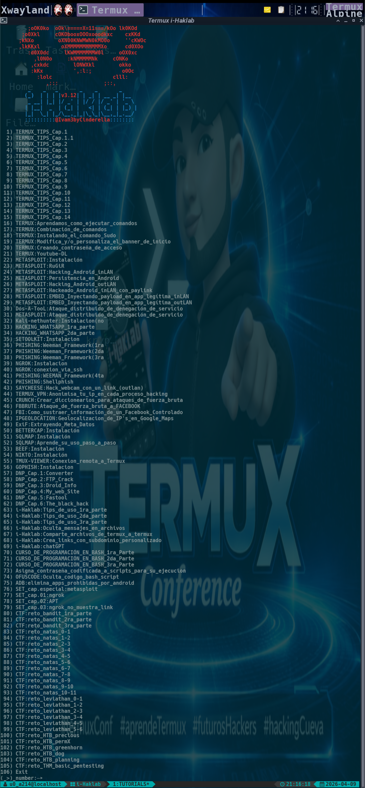
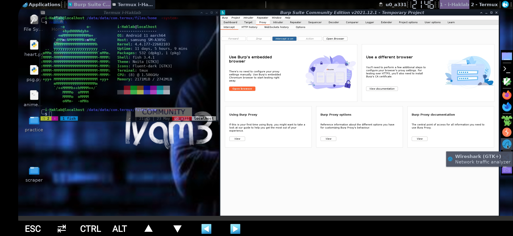

<div align="center">

</div>


<div align="center">
<a href="https://git.io/typing-svg"></a>
</div>

## Video tutorial

[](https://youtu.be/1mpBI0hltA4)

## Contents

- [What is Termux?](#-what-is-termux)
- [What is i-HakLab?](#-what-is-i-haklab)
- [Installation](#-installation)
- [Video tutorial](#video-tutorial)
- [AI coding agents and vibecode tools](#-ai-coding-agents--vibecode-tools)
- [What i-HakLab can do](#-i-haklab-will-)
- [Available tools by category](#available-tools-by-category)
- [Books and tutorials](#-books-availables)
- [Commands](#-commands)
- [Desktop environment](#-desktop-environment)
- [Update](#-update-at-newest-version)

> [!NOTE]
>  The main objective of the creation of this laboratory is to transport the applications, tools and/or frameworks of a Linux computer environment to the palm of the user's hand thanks to the portability that the Android operating system can provide us. We hope that this project will help contribute to the cybersecurity community and that people can develop efficient countermeasures. The use of i-Haklab without prior mutual consistency may lead to illegal activity. It is the end user's responsibility to obey all applicable local, state, and federal laws. The authors take no responsibility and are not responsible for any misuse or damage caused by this program

<div align="center">

[](https://git.io/typing-svg)

</div>

<div align="center">
  <a href="https://www.youtube.com/c/Ivam3byCinderella" target="_blank">
    
  </a>
  <a href="http://github.com/ivam3" target="_blank">
    
  </a>
  <a href="https://whatsapp.com/channel/0029VaM2Qbd9MF8wiloJx510" target="_blank">
    
  </a>
  <a href="https://t.me/Ivam3bCinderella" target="_blank">
    
  </a>
</div>


##### To get help join to our support groups over [Telegram group](https://t.me/Ivam3by_Cinderella) or over deepwiki AI assistant: [DevinAI](https://deepwiki.com/ivam3/i-Haklab)

### 🤔 What is Termux?
> [Termux](https://github.com/termux/termux-app) is a terminal emulator application that shares the same environment of the Android operating system by starting the command line of the program `shell` using the system call `execve` and redirecting the input, output and standard error flows to the screen. [Termux](https://github.com/termux/termux-app) has a vast number of packages under the `apt` manager compiled with Android NDK and patched for compatibility, generally available on GNU/Linux systems.


### 🤔 What is i-Haklab?
> [i-Haklab](https://github.com/ivam3/i-Haklab) is a hacking laboratory for [Termux](https://github.com/termux/termux-app) that contains [open source tools](https://github.com/ivam3/termux-packages) for osint, pentesting, scan/find vulnerabilities, exploitation, post-exploitation, reverse engineering, malware analysis, development, coding, vibe coding and frontier AI agents recommended for me [Ivam3](https://wlo.link/@Ivam3) with automation commands, a many guides, books and tutorials to learn how to use tools. [i-Haklab](https://github.com/ivam3/i-Haklab) use oh my fish insteractive shell as default (users can change it for zsh or bash) to provide core infrastructure to allow you to install packages which extend or modify the look of your termux. To get help about shell and its use going to [OMF official site](https://fishshell.com/docs/current/tutorial.html).

### IA ASSISTANT
[](https://deepwiki.com/ivam3/i-Haklab)

Join to [deepwiki](https://deepwiki.com/ivam3/i-Haklab) and learn more about this project asking to Devin, our IA assistant trained with all the information about this project and its tools.

### 📦 INSTALLATION.
- OPTION 1 (RECOMMEND): ADDING AT APT SOURCES LIST
```bash
curl -fsSL "https://raw.githubusercontent.com/ivam3/termux-packages/gh-pages/install.sh" | bash
```

- OPTION 2: CLONING THIS REPOSITORY:
```bash
git clone https://github.com/ivam3/i-Haklab
cd i-Haklab
chmod +x setup
bash setup
```

- OPTION 3: INSTALLING A RELEASE VERSION:
1. Go to [releases section](https://github.com/ivam3/i-Haklab/releases)
2. Download the .deb file of your choice
3. Install it with:
```
apt install ./path/at/i-haklab_example_all.deb
```

### 🤖 AI CODING AGENTS & VIBECODE TOOLS
> i-Haklab integrates the most advanced AI coding agents and tools to transform your Termux into a full vibecode development environment. Whether you prefer native packages or JavaScript/Python ecosystems, all agents are one command away.

**Installation methods:**
- 📦 `apt install` — Native Termux packages (glibc-adapted binaries)
- 📦 `npm install -g` — Node.js global packages (wrapper normalizes names automatically)
- 📦 `pnpm install -g` — pnpm alternative
- 📦 `npx` — Ephemeral execution without permanent install

<details>
<summary>**🧠 AI Coding Agents** ↩️ </summary>

| Agent | apt | npm | pnpm | npx | Description |
|-------|:---:|:---:|:----:|:---:|-------------|
| **opencode** | ✅ `apt install opencode` | ❌ | ❌ | ❌ | Universal AI coding agent (AGI), glibc-native binary for Termux |
| **opencode-v2** | ✅ `apt install opencode-v2` | ❌ | ❌ | ❌ | OpenCode v2 (2.0.32), glibc-native binary; installs as `opencode-v2` and coexists with v1 |
| **claude-code** | ✅ `apt install claude-code` | ✅ `npm install -g claude-code` | ✅ | ❌ | Anthropic's AI coding agent, pre-built for Termux |
| **deepseek-harness** | ✅ `apt install deepseek-harness` | ❌ | ❌ | ❌ | DeepSeek AI coding harness with a local web UI, glibc-native Node.js runtime (CLI: `dsh`) |
| **openclaw** | ✅ `apt install openclaw` | ❌ | ❌ | ❌ | Autonomous AI agent with full platform/scripts/patches suite |
| **qwen-code** | ❌ | ✅ `npm install -g qwen-code` | ✅ | ❌ | Alibaba's Qwen coding agent (wrapper: `@qwen-code/qwen-code`) |
| **mistral-vibe** | ✅ `apt install mistral-vibe` | ❌ | ❌ | ❌ | Mistral AI agent — Python package via `uv`, CLI: `vibe` |
| **antigravity-cli** | ✅ `apt install antigravity-cli` | ❌ | ❌ | ❌ | AGI coding agent, glibc-native binary, CLI: `agy` |
| **copilot-cli** | ❌ | ✅ `npm install -g copilot-cli` | ✅ | ❌ | GitHub Copilot CLI (wrapper: `@github/copilot`) |
| **codebuff** | ✅ `apt install codebuff` | ❌ | ❌ | ❌ | Buffcode AI agent, glibc-native binary |
| **freebuff** | ✅ `apt install freebuff` | ❌ | ❌ | ❌ | Community free version of codebuff |
| **mimocode** | ✅ `apt install mimocode` | ❌ | ❌ | ❌ | Mini AI coding agent, glibc-native binary |
| **cactus** | ✅ `apt install cactus` | ❌ | ❌ | ❌ | Hybrid edge-cloud AI engine: on-device LLM/VLM/speech inference (Cactus Engine) + `cactus convert` |
| **hermes-agent** | ✅ `apt install hermes-agent` | ❌ | ❌ | ❌ | Personal AI agent by Nous Research (CLI, TUI, desktop & messaging gateway) |
| **muse-code** | ✅ `apt install muse-code` | ❌ | ❌ | ❌ | Meta AI coding agent for the terminal (runs under proot for Android) |
| **omniroute** | ✅ `apt install omniroute` | ❌ | ❌ | ❌ | Multi-proxy routing manager (TOR/SOCKS5/HTTP/chain proxies) for AI agents |
| **walkie** | ✅ `apt install walkie` | ❌ | ❌ | ❌ | P2P communication CLI for AI agents (no server, no setup) |
| **codex-cli** | ❌ | ✅ `npm install -g codex` | ✅ | ❌ | Codex CLI (wrapper: `@mmmbuto/codex-cli-termux`) |
| **kimi-code** | ❌ | ✅ `npm install -g kimi-code` | ✅ | ❌ | Moonshot AI coding agent (wrapper: `@moonshot-ai/kimi-code`) |
| **sleepwalker** | ❌ | ✅ `npm install -g sleepwalker` | ❌ | ❌ | AI Visibility & Content Intelligence CLI (wrapper: `@sleepwalkerai/cli`) |
| **smithery** | ❌ | ✅ `npm install -g smithery` | ✅ | ❌ | MCP servers marketplace & unified proxy (wrapper: `@smithery/cli`) |
| **minimax-cli** | ❌ | ✅ `npm install -g minimax-cli` | ✅ | ❌ | MiniMax AI agent (wrapper: `mmx-cli`) |
| **open-lovable** | ❌ | ✅ `npm install -g open-lovable` | ✅ | ❌ | Lovable dev agent (wrapper clones `firecrawl/open-lovable`) |
| **codecompanion** | ❌ | Via Neovim (`olimorris/codecompanion.nvim`) | ❌ | ❌ | AI plugin for Neovim with Gemini/OpenAI/Anthropic/Copilot/Mistral adapters. Activated on first `nvim` launch via lazy.nvim |

</details>

<details>
<summary>**🛠️ Associated Tools & Runtimes** ↩️ </summary>

| Tool | apt | npm | pnpm | npx | Description |
|------|:---:|:----:|:----:|:---:|-------------|
| **engram** | ✅ `apt install engram` | ❌ | ❌ | ❌ | Persistent memory system for AI agents (Go binary, clones + compiles from source) |
| **playwright-proot** | ✅ `apt install playwright-proot` | ❌ | ❌ | ❌ | Headless Chromium browser via proot Ubuntu for AI agent testing (aarch64) |
| **context7 (ctx7)** | ❌ | ✅ `npm install -g ctx7` | ❌ | ✅ `npx ctx7@latest` | Documentation & code example retrieval for AI agents (MCP-compatible) |
| **openspec** | ❌ | ✅ `npm install -g openspec` | ✅ `pnpm install -g openspec` | ❌ | Open-source LLM spec generator (wrapper: `@fission-ai/openspec`) |
| **termux-oracle-skill** | ✅ `apt install termux-oracle-skill` | ❌ | ❌ | ❌ | Termux expert skill for AI agents — context about Termux, i-Haklab & 189 tools |
| **huggingface** | ✅ `apt install huggingface` | ❌ | ❌ | ❌ | Client library for the Hugging Face Hub (`huggingface_hub`) — download/publish AI models & datasets via `huggingface-cli`/`hf` |
| **n8n** | ❌ | ✅ `npm install -g n8n` | ✅ `pnpm install -g n8n` | ❌ | Workflow automation with SQLite backend (wrapper auto-installs pm2/gyp pre-reqs) |

</details>

**💡 Pro tips:**
- `apt install <agent>` works for all agents with a 📦 badge — the i-Haklab apt wrapper intelligently redirects npm/pip packages automatically
- `opencode` (v1) and `opencode-v2` can coexist: install both and use the `opencode` and `opencode-v2` commands
- Need a quick test? Use `npx ctx7@latest` without installing anything
- After installing any agent, i-Haklab's `pkg2conf` auto-configures it for the environment
- All Neovim AI adapters (codecompanion) are pre-configured — just press a key and start vibecoding
- Run `i-Haklab about <agent>` for detailed help on any of these tools

### 🧠 i-Haklab will ...
- Show information about any tool or framework:
```bash
i-Haklab about <name_of_tool>
```
- Show the full command reference or the installed version:
```bash
i-Haklab help
i-Haklab version
```
- Provide different types of prompt for shell fish with command:
```bash
omf theme
```
- Switch shell between bash, zsh and fish(default):
```bash
i-Haklab setshell
```
- Run linux distributions in proot environment (CLi or Graphical), or list them:
```bash
i-Haklab pd <distro> [X11]
i-Haklab pd list
```
- Provide a login session by password (default: Ivam3byCinderella) or fingerprint:
```bash
i-Haklab passwd set
i-Haklab passwd new
```
- Let you change the banner and username:
```bash
i-Haklab setbanner
i-Haklab setuser
```
- Let you update Termux system package by package:
```bash
i-Haklab aptup
```
- Provide network speed test and public IP:
```bash
i-Haklab speedtest
mypip
```
- Extract massive information from Android devices via ADB:
```bash
i-Haklab androforensic secretCodes|airscope|dumpsys|extract <target>
```
- Create a Termux backup and/or restore it:
```bash
i-Haklab backup create in|ex
i-Haklab backup restore <path/to/termux-backup.tar.gz>
```
- Automate brute force attacks (FTP, Mail, SSH, Telnet):
```bash
i-Haklab bruteforce ftp|mail|ssh|telnet
```
- Let you interact with ChatGPT-3 via CLI:
```bash
i-Haklab chatAI
```

- Get the main activity from an .apk file:
```bash
i-Haklab apkactivity <path/to/file.apk>
```

- Show the current ngrok link / connect via SSH with ngrok:
```bash
i-Haklab ngroklink
i-Haklab ngrokssh -p <port> -t <protocol> -f <id_rsa-file>
```
- Add your API keys for various services:
```bash
i-Haklab setapikey
```
- Encode/decode secret messages into ASCII files:
```bash
i-Haklab ESmsg encode|decode
```
- Convert ova files and run QEMU virtual machines (no root):
```bash
i-Haklab qemufy <VM_image.zip>
i-Haklab qemufy rm [image]
```
- Start a local TCP tunnel and expose a local port:
```bash
i-Haklab tunnel
i-Haklab tunnel -p 8880 -s my-owner-cloud
```
- Provides a server for storage and sharing of multimedia files:
```bash
i-Haklab 4share <server_name>
```
> Server names: `localtunnel`, `localhost.run` and `cloudflared`. Default credentials: `Admin:password`.
- Automate Metasploit processes (Payloads, Handlers, Shodan, Dirscan):
```bash
i-Haklab msf dirscan <target>
i-Haklab msf embed <host> <port> <file.apk>
i-Haklab msf payapk|payexe|paypdf <host> <port>
i-Haklab msf shodan
i-Haklab handler <file.rc>
```
- Get information about BINs (CC, DC):
```bash
i-Haklab binchecker
```
- Provide telephone number information:
```bash
i-Haklab phonescan <number>
```
- Test USB devices via OTG:
```bash
i-Haklab usbtest <path-to-device>
```
- Text to speech (Edge-TTS neural voices) + merge audio into video for shorts:
```bash
i-Haklab txt2media -t "hello world" -o short01
i-Haklab txt2media -f note.txt -o short02 -v es-MX-JorgeNeural
i-Haklab txt2media --video base.mp4 --audio short01.mp3 -o final.mp4
```
- Provide vulnerable servers for testing (bWAPP, DVWA, MUTILLIDAE):
```bash
i-Haklab servers4test
```

- Bring you several automations to setup tools installed with apt, npm, pip, gem, etc. For example once execute 'apt install neovim', i-Haklab will setup it with predictable text editor settings and all AI coding agents (see [🤖 AI Coding Agents section](#-ai-coding-agents--vibecode-tools)) to vibecode experience over Termux.

[](./assets/ia_nvim.gif)
- Watch the video 👆🏼

- Provide [189 tools/frameworks](https://github.com/ivam3/termux-packages) with an easy install/remove. List them with:
```bash
i-Haklab show alltools
i-Haklab show instatools
```


### Available tools by category

**Full breakdown of the 189 available tools by category (`i-Haklab show alltools`):**

| Category | Tools |
|---|---|
| **Brute Force** | acccheck, hydra-gtk, kerbrute |
| **Android** | adbfastboot, apkeditor, apktool, androidsdk-cli, apksigner, appshark, axmlprinter2, dex2jar, frida, objection, phonesploit, scrcpy, termux-apk-make, xml2axml |
| **Exploitation** | afrog, beef, bitb-framework, cryptovenom, dos-a-tool, embed, exploitdb, metasploit-framework, penelope, quack, ransomux, slowhttptest |
| **Utilities** | aguila-lang, bash-obfuscate, code-oss, code-server, converter, gh, git-filter-repo, glab-cli, jython-lts, mariadb, markdown-viewer, nljson, openjdk-21, openspec, pnpm, postgresql, proroot, spin, sqlite, speedtest-go, termux-desktop-bspwm, termux-desktop-xfce, termux-docker-qemu, tmux, translate-shell, ttyd, udocker, xapt-management, yt-dlp, ytfzf |
| **Network Scanning** | aircrack-ng, bettercap, dnsenum, enum4linux, enum4linux-ng, nmap, rustscan |
| **OSINT** | amass, finalrecon, geo-recon, ghunt, h8mail, holehe, infoga, ipgeolocation, maltego, octosuite, orbitaldump, osintgram, osrframework, phoneintel, recon-ng, recondog, scrapy, sherlock, shodan, snscrape, sublist3r, twifo-cli, virustotal-cli, xleak |
| **AI Agents** | antigravity-cli, claude-code, codebuff, codex, copilot-cli, deepseek-harness, freebuff, hermes-agent, kimi-code, mimocode, minimax-cli, mistral-vibe, muse-code, ollama, open-lovable, openclaw, opencode, opencode-v2, qwen-code, zcode, zcode-cli |
| **Web Application** | aquatone, burpsuite, dirb, findomain, fuzzdb, gobuster, nikto, routersploit, sqlmap, telegram-desktop, vulnx, webhackshl, websploit, wfuzz, whatweb, wpscan, zaproxy |
| **Cloud** | azure-cli, cloudbunny, hatcloud, railway-cli |
| **Forensics** | binwalk, clamav, exif, gdb, ghidra, hexer, mvt, radare2, rea, shc, steghide, stegsnow, unshc |
| **Windows/AD** | bloodhound, getadusers, getnpusers, getuserspns, mimikatz, ntlmrelayx, polenum |
| **Phishing** | botgram, evilginx2, ghost, gophish |
| **AI & Automation** | cactus, engram, herdr, huggingface, n8n, omniroute, sleepwalker, walkie |
| **Password** | cewl, crunch, seclists |
| **Games** | clmystery, comandle, terminus-game |
| **Tunneling** | cloudflared, dns2tcp, localtunnel, ngrok, ovh-ttyrec, putty |
| **MCP & Skills** | context7, playwright-proot, smali-lsp, smithery, termux-oracle-skill, testsprite |
| **Cracking** | hashcat, hasher, hashid, hcdecryptor, johntheripper, rhash |
| **Uncategorized** | obs-studio |

- Provides free support material for learning the [included tools](https://github.com/ivam3/termux-packages) and use of the shell in Termux.
```
i-Haklab show books
i-Haklab show tutorials
```
### 📕 BOOKS AVAILABLES



### 📕 TUTORIALS AVAILABLES



### 🪄 COMMANDS
> There are several commands in [i-Haklab](https://github.com/ivam3/i-Haklab) that facilitate the use of [Termux](https://github.com/termux/termux-app):

- [i-Haklab](https://github.com/ivam3/i-Haklab): main command for automations. See all features with:

 <details>
<summary>**List of Direct Commands** ↩️   </summary>

- **apt**: Install/remove and **configure** packages, tools and frameworks.
- **adminfiles**: Copy files from internal or external storage into the Termux directory.
- **ai**: Asistente IA: natural language → terminal command (ollama/groq, local/cloud, voice).
- **bat**: Enhanced 'cat' with syntax highlighting.
- **cmd**: Manage Android settings.
- **df / du**: Disk and directory usage information.
- **fixer**: Automate fixing Termux issues.
- **fzf**: Fuzzy finder.
- **gitbrowsering**: Search GitHub repositories.
- **glow**: Read markdown files with syntax highlighting.
- **LOCALHOST**: Show the current IP address on the LAN.
- **mypip**: Show the public internet IP address.
- **lock**: Secure Termux screen.
- **nls**: Enhanced 'ls' rendering entries in boxes/grid.
- **net-traffic-scan**: Network traffic monitor via ADB (grid, history & fallback) — bypasses `untrusted_app` `Permission denied` on `/proc/net` via `adb shell` `readproc` (no root). Example: `net-traffic-scan --once --grid` / `--no-grid` / `--dry-run` (logs to `~/.local/share/traffic/`).
- **openvpn**: Open OpenVPN Android application.
- **omf**: Change Oh-my-fish theme.
- **phantom-ps**: Manage phantom processes limit (Android 12+, 32b) — validate (`!=32` → `2147483647`), `--set <0-2147483647>`, `--always` (persistent + whitelist), `--restore` (per API).
- **pm**: Android package manager.
- **postgresql**: Manage PostgreSQL database.
- **proxy**: Connection via proxychains4/Tor.
- **rmcache**: Remove session cache, temporary files and residual APT packages.
- **serverapache / serverphp**: Web servers.
- **sudo**: Execute commands or start an environment as a fake root user.
- **telegram**: Open Telegram Android application.
- **traductor**: Command line translator.
- **ttyd**: Run ttyd server to access Termux remotely via web browser.
- **walkie-tg**: Connection's bridge between walkie server and telegram's bot.
- **yazi**: Terminal file manager.
</details>


### 🎴 DESKTOP ENVIRONMENT
> [i-Haklab](https://github.com/ivam3/i-Haklab) automates the installation and configuration of a graphical environment with the Xfce4 window manager. It requires [Termux:X11](https://github.com/termux/termux-x11).
```bash
pkg install termux-desktop-xfce
i-Haklab desktop
```


### 🔥 UPDATE AT NEWEST VERSION 
> [i-Haklab](https://github.com/ivam3/i-Haklab) is constantly updating tools and improvements. To stay updated, run:
```bash
pkg update
pkg upgrade i-haklab
```

**Explore and search this repository with AI on [DeepWiki](https://deepwiki.com/ivam3/i-Haklab)**

##### Join to our community [Ivam3byCinderella](https://ivam3.github.io/#/redes) and check all stuffs we have for you.
